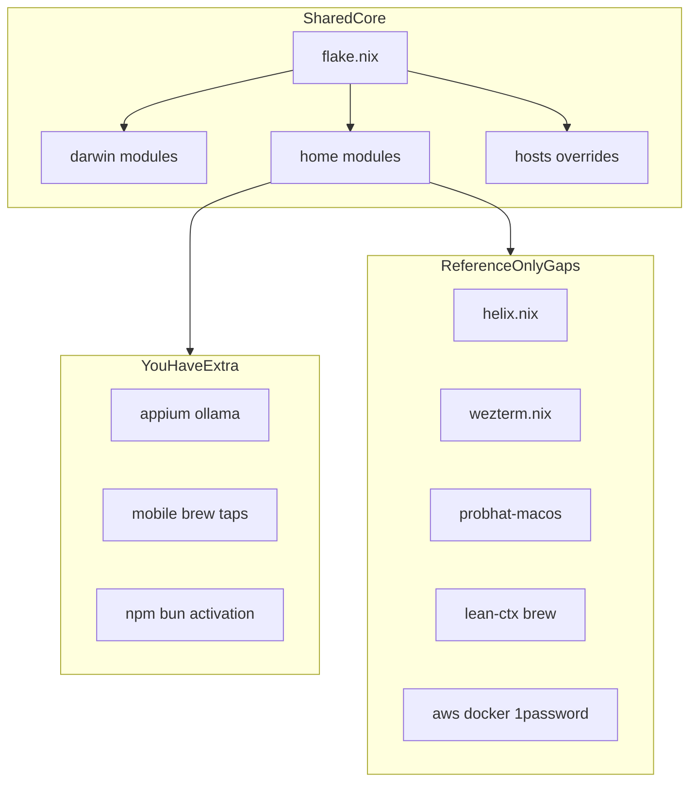

# Gap analysis vs audacioustux/flakes.nix

You can use this report to decide which packages, apps, and config modules from the reference flake to add to your macOS Nix setup without dropping your mobile and test tooling.

## Scope and sources

| Side | Path / URL | Notes |
| --- | --- | --- |
| Yours | `~/.config/nix` | nix-darwin + Home Manager + nix-homebrew |
| Reference | https://github.com/audacioustux/flakes.nix | Compared at commit `2656aea6e6febbe1e542235b35ec397539733d21` |

**Verdict:** the architecture matches. You are ahead on mobile and test tooling. You are behind on some DevOps command-line tools (CLIs), editor and terminal modules, and a few Homebrew graphical apps (casks).

Keep your Appium, Flutter Version Manager (FVM), Java Development Kit (JDK), simulator, and npm/bun activation packages. Only add reference items you need.

## Architecture map



## Shared core (not a gap)

Both repos already share:

| Area | What both do |
| --- | --- |
| Layout | `flake.nix`, `darwin/`, `home/`, `hosts/` |
| Stack | nix-darwin, Home Manager, nix-homebrew |
| Nix installer | Determinate Nix (`nix.enable = false`) |
| Features | `nix-command`, flakes, store auto-optimise, unfree allowed |
| macOS | Touch ID for sudo, primary user shell = zsh |
| Home | packages, git, shell (zsh + oh-my-zsh), gpg-agent |
| Host overrides | empty cask and package hooks ready per machine |

## Priority A — packages, tools, and apps in the reference that you lack

Active entries only (commented wish-list items in either repo are ignored).

### How to use the checkboxes

1. Mark **Include** as `[x]` for each item you want added to the config files.
2. Mark **Enabled** as `[x]` to activate now, or leave `[ ]` to keep the line commented/deferred.
3. Use **Notes** for constraints, preferred path, or why you want it (optional).
4. For 1Password and Claude Code, mark **only one** install path.
5. Tell the agent: `implement checked includes`.
6. The agent updates the flake, then marks **Configured** as `[x]` and sets **Enabled** to match the files.

**Configured** means the item is present in your Nix or Homebrew config files (active or commented). It does not mean `darwin-rebuild` has succeeded.

**Enabled** means the item is active (not commented) in those files.

Optional packages are toggled with `my.features.*.enable` in [`modules/features.nix`](../modules/features.nix) (not by commenting lines).

### A1. Nix `home.packages` present in reference, missing or different in yours

| Package | In reference | In yours | Action | Include | Enabled | Configured | Notes |
| --- | --- | --- | --- | --- | --- | --- | --- |
| `helix` | yes | commented out | Add only if you want Helix as editor | [ ] | [ ] | [ ] | |
| `zellij` | yes | commented out | Add only if you want Zellij terminal multiplexer | [x] | [x] | [x] | |
| `docker-client` | yes | no | Add if you use Docker CLI against OrbStack or Docker Desktop | [x] | [x] | [x] | |
| `awscli2` | yes | no | Add if you use Amazon Web Services (AWS) CLI | [x] | [ ] | [x] | deferred via `my.features.awscli.enable` (default false) |
| `aws-iam-authenticator` | yes | no | Add if you authenticate to Kubernetes on AWS | [x] | [ ] | [x] | gated with `my.features.awscli.enable` |
| `_1password-cli` | yes | no | Nix path for `op` — do not also mark A2 `1password-cli` | [x] | [x] | [x] | |
| `rustup` | yes | no — you ship `rustc`/`cargo`/`rustfmt`/`clippy` | Keep yours unless you need toolchain switching via rustup | [x] | [x] | [x] | |
| `nodejs_22` | yes | no — you ship `nodejs_24` | Keep Node 24 unless a project forces 22 | [ ] | [ ] | [ ] | |

### A2. Homebrew casks present in reference, missing in yours

| Cask | In reference | In yours | Action | Include | Enabled | Configured | Notes |
| --- | --- | --- | --- | --- | --- | --- | --- |
| `betterdisplay` | yes | commented | Add if you need display control | [x] | [x] | [x] | |
| `orbstack` | yes | no | Add if you want Docker/Linux containers on macOS | [x] | [x] | [x] | |
| `zed` | yes | commented | Add if you want the Zed editor | [ ] | [ ] | [ ] | |
| `discord` | yes | commented | Add if you use Discord | [ ] | [ ] | [ ] | |
| `1password-cli` | yes (cask) | no | Homebrew path for `op` — do not also mark A1 `_1password-cli` | [ ] | [ ] | [ ] | |
| `claude-code` | yes (cask) | no — was npm `@anthropic-ai/claude-code` | Switch to this cask or keep npm; do not keep both | [x] | [x] | [x] | Switch to this cask, remove npm `@anthropic-ai/claude-code` |

Reference also enables `wizcli`; you already have that cask.

### A3. Homebrew brews and taps present in reference, missing in yours

| Item | Kind | Action | Include | Enabled | Configured | Notes |
| --- | --- | --- | --- | --- | --- | --- |
| `yvgude/lean-ctx` | tap | Add if you want LeanCTX context tools | [x] | [x] | [x] | |
| `yvgude/lean-ctx/lean-ctx` | brew | Add with the tap above | [x] | [x] | [x] | |

### A4. Not gaps (equivalent coverage)

| Reference item | Your equivalent |
| --- | --- |
| `gh` in `home.packages` | `programs.gh.enable` in `home/git.nix` |
| `bun` in Nix packages | `bun` Homebrew brew |
| `direnv` / `zoxide` as Home Manager programs | package + oh-my-zsh plugins |
| `k9s`, `uv`, `curl`, `neovim`, `btop`, `tree`, `ripgrep` | same or present |
| `pkgsMaster.opencode`, `pkgsMaster.gemini-cli` | same |
| `nerd-fonts.monaspace` | same |

## Priority B — non-package gaps you can include

| Gap | Reference | Yours | When to include |
| --- | --- | --- | --- |
| Helix module | `home/helix.nix` (theme, keys, language servers) | none | After you add the `helix` package |
| WezTerm module | `home/wezterm.nix` | none (cask commented; known nix-homebrew friction) | Only if you adopt WezTerm and accept TCC/signing trade-offs |
| Probhat layout | flake input `probhat-macos` + `programs.probhat.enable` | none | Only if you need Bangla Probhat keyboard layout |
| `nix-direnv` | `programs.direnv` + `nix-direnv.enable` | direnv package only | Yes if you use Nix shells in project directories |
| `programs.zoxide` | Home Manager module | package + plugin | Optional polish |
| `home.sessionPath` | includes `~/.local/bin` | set in zsh `initContent` | Optional cleanup |
| `AWS_PAGER = ""` | zsh session variable | none | Add with AWS CLI |
| oh-my-zsh plugins | `git`, `docker`, `1password` | `git`, `zoxide`, `direnv`, `aws`, `react-native`, `flutter` | Merge only plugins you use; keep mobile plugins |
| Docker Desktop path | `/Applications/Docker.app/Contents/Resources/bin` on `systemPath` | Homebrew path only | Add if Docker Desktop credentials helper is needed |
| App copy checks | `targets.darwin.copyApps.enableChecks = false` | unset | Add if Nix-managed GUI apps hit false TCC denials |
| README adopt flow | install + `# CHANGE:` checklist | short usage README | Worth copying for onboarding |
| Identity | reference uses its own username/host | `identity.local.nix` (`primaryUser`, `hostName`, `sshPrivateKeys`); example in `identity.example.nix` | Copy example per machine; do not commit local file |

## What you have that the reference does not

Do not remove these to “match” the reference.

| Area | Your extras |
| --- | --- |
| Mobile / test | Appium module, Appium Inspector, applesimutils, set-simulator-location, idb-companion, ios-deploy, watchman, bundletool, gstreamer |
| Languages / SDKs | Dart, PHP 8.2, FVM, fnm, Zulu JDK 11/17, CocoaPods |
| Cloud / ops | Google Cloud SDK, kubectl, MySQL 8.4, sops, ollama (brew + module) |
| Activation | npm globals (`claude-code`, `eas-cli`), bun global (`pi-coding-agent`) |
| Home Manager | `backupFileExtension = "backup"` |
| Shell | `ZDOTDIR` via `/etc/zshenv`, Android SDK path helpers, Java switch helper |
| nix-darwin pin | `nix-darwin-26.05` (reference tracks unpinned `lnl7/nix-darwin`) |

## Step-by-step include plan

### Step 0 — unblock first switch

**Status (this Mac):** identity via `identity.local.nix` (`primaryUser`, `hostName`, `sshPrivateKeys`); host dir `hosts/k-m-r-dev/`.

1. Confirm macOS username: `id -un` (or `whoami`).
2. Confirm hostname: `scutil --get LocalHostName` (or `hostname`).
3. `cp identity.example.nix identity.local.nix` and set `primaryUser`, `hostName`, and `sshPrivateKeys` (SSH private key **basenames** under `~/.ssh` only).
4. Ensure `hosts/<hostName>/configuration.nix` exists for that `hostName`.
5. Install Nix with the Determinate installer if `nix` is missing.
6. Do not rebuild until identity matches, or Home Manager will target the wrong home directory. Never commit `identity.local.nix`.

### Step 1 — add Priority A items from the checkboxes

1. Mark **Include** in sections A1–A3 above.
2. Say `implement checked includes`.
3. Prefer one install path per tool (Nix **or** Homebrew, not both).

### Step 2 — Claude Code path

Pick one via the A2 `claude-code` checkbox, or leave it unchecked to keep npm:

| Path | Where |
| --- | --- |
| Keep current | npm activation `npm_ensure_latest @anthropic-ai/claude-code` |
| Match reference | Mark A2 `claude-code` Include; agent removes the npm install for that package |

### Step 3 — port modules only after packages exist

**Status (this Mac):** skipped for now.

| Module | Evidence |
| --- | --- |
| Helix | `my.features.helix.enable` defaults to false; A1 Include unchecked |
| WezTerm | not Included; known nix-homebrew friction |

1. If Helix is enabled later: add `home/helix.nix`, import from `home/default.nix`, install language servers/formatters (`nil`, `nixfmt`, `rust-analyzer`, `typescript-language-server`, `pyright`, `prettier`, `ruff`) or trim the language block.
2. If WezTerm is adopted: add `home/wezterm.nix`, set `targets.darwin.copyApps.enableChecks = false`, and verify TCC after the first activation.

### Step 4 — optional quality upgrades

**Status (this Mac):**

| Item | Status |
| --- | --- |
| `programs.direnv` + `nix-direnv` | applied in `home/shell.nix` |
| `programs.zoxide` + `home.sessionPath` | applied in `home/shell.nix` |
| `AWS_PAGER` | gated on `my.features.awscli.enable` (still false) |
| Docker Desktop `systemPath` | applied (`/Applications/Docker.app` present) |
| Probhat | skipped (not requested) |
| oh-my-zsh mobile plugins | kept `react-native` / `flutter`; removed `direnv`/`zoxide` plugins (HM owns them) |

1. Replace bare direnv package usage with Home Manager `programs.direnv` + `nix-direnv.enable` if you use flakes in project dirs.
2. Add `AWS_PAGER = ""` when AWS CLI is added.
3. Add Docker Desktop `systemPath` entry only if that app is installed.
4. Add `probhat-macos` only if you need that keyboard layout.
5. Merge oh-my-zsh plugins carefully; keep `react-native` / `flutter` if you still use them.

### Step 5 — rebuild and verify

**Status (this Mac):** switch applied via identity-selected flake attr (Determinate Nix + nix-darwin activate). Note: Homebrew cask `appium-inspector` is Gatekeeper-disabled upstream; Touch ID sudo PAM left off on macOS 26.

First apply (after Nix is installed and `identity.local.nix` exists):

```bash
cd ~/.config/nix
sudo nix run nix-darwin -- switch --flake ~/.config/nix#$(./scripts/identity-host.sh)
```

Later applies:

```bash
~/.config/nix/scripts/nix-switch.sh
# or
sudo darwin-rebuild switch --flake ~/.config/nix#$(~/.config/nix/scripts/identity-host.sh)
```

Smoke-check after switch: `docker`, `op`, `lean-ctx`, and your Appium/FVM paths. `aws` / Helix should be absent unless those features are enabled.

## Recommended default order (if unsure)

1. Fix `identity.local.nix` (`primaryUser` / `hostName` / `sshPrivateKeys`).
2. Mark DevOps CLIs and OrbStack Include boxes only if you use AWS/Docker daily.
3. Leave Claude unchecked to keep npm unless you want the brew cask.
4. Skip Helix/WezTerm/Probhat until you deliberately switch editors or keyboard layout.
5. Add `nix-direnv` when project Nix shells become common.
6. Never drop mobile/test packages to mirror the reference.

## Evidence files

| Topic | Your file | Reference file |
| --- | --- | --- |
| Flake inputs / identity | `flake.nix`, `identity.local.nix` (tracked separately from flake.nix), `identity.example.nix` | `flake.nix` |
| Nix packages | `home/packages.nix` | `home/packages.nix` |
| Homebrew | `darwin/homebrew.nix` | `darwin/homebrew.nix` |
| Darwin system | `darwin/default.nix` | `darwin/default.nix` |
| Shell | `home/shell.nix` | `home/shell.nix` |
| Home imports | `home/default.nix` | `home/default.nix` |
